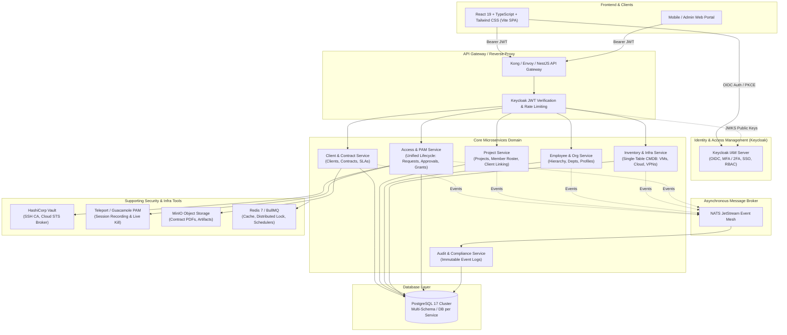
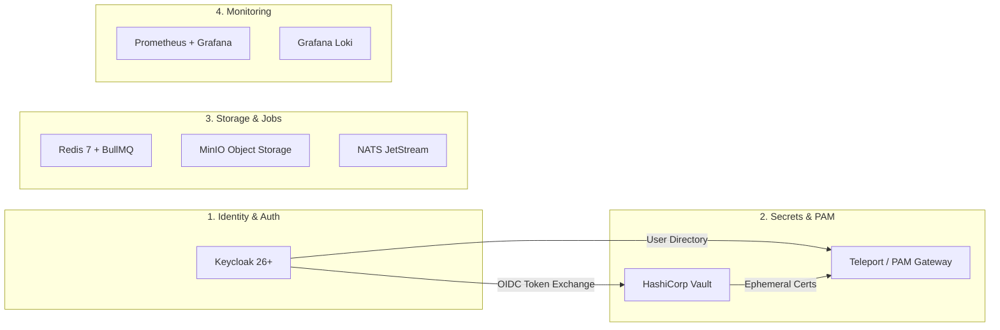
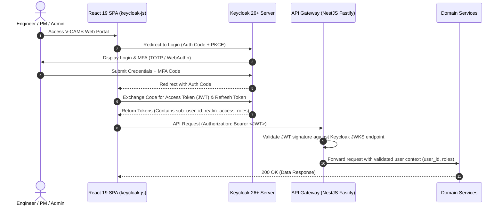
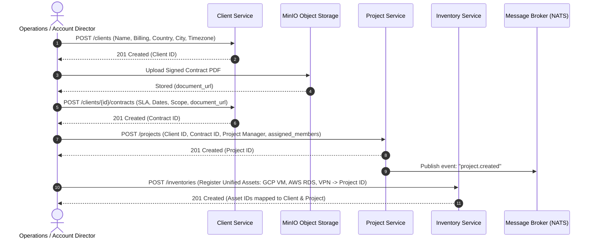
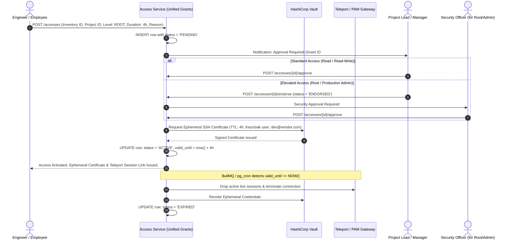
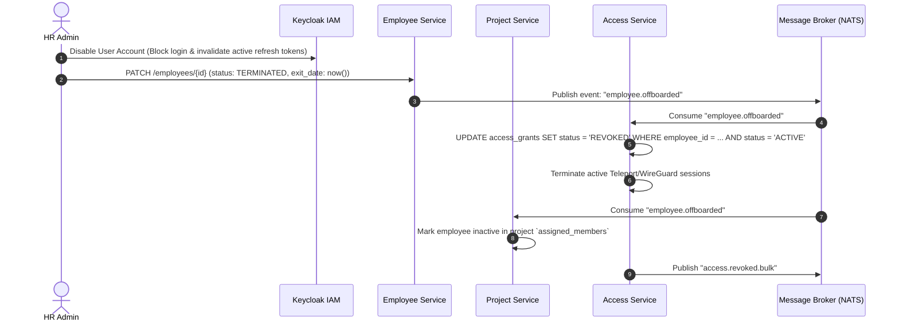

# Multi-Tenant Vendor & Client Asset Management System (V-CAMS)
## Technical Specification & Architecture Design Document (Unified & Streamlined)

---

## 1. System Overview & Architecture

### 1.1 Business Context
The organization operates as a specialized **3rd-Party Managed Service Provider (MSP) / Vendor** responsible for managing both:
1. **Internal Assets**: Internal infrastructure, tooling, corporate VPNs, development environments, and shared internal servers.
2. **Client Assets**: Client-owned or client-dedicated cloud infrastructure (AWS, GCP, Alibaba Cloud, DigitalOcean, Azure), Virtual Machines (VMs), VPCs/VPN tunnels, database clusters, and domain configurations governed under distinct contractual agreements.

### 1.2 Core Architectural Principles
* **Architecture Style**: Microservices Architecture communicating via REST/HTTP (API Gateway) and Asynchronous Event-Driven Messaging (NATS JetStream / RabbitMQ) for domain events (e.g., `EMPLOYEE_OFFBOARDED`, `ACCESS_REVOKED`, `CONTRACT_EXPIRED`).
* **Identity & Access Management (IAM / SSO)**: **Keycloak 26+** (OpenID Connect / OAuth 2.0, Multi-Factor Authentication TOTP/WebAuthn, fine-grained RBAC, LDAP/Google Workspace federation).
* **Backend Runtime & Framework**: **Node.js 22 LTS / Bun** with **NestJS (TypeScript)** using Fastify engine for high throughput and modular domain isolation.
* **Frontend**: **React 19 (TypeScript)** + **Vite** + **Tailwind CSS** + **Shadcn/UI** + **TanStack Query (v5)** + **Zustand** + **React Flow** (for Org Chart & Infrastructure Topology diagrams).
* **Database**: **PostgreSQL 17** with `ltree` (for hierarchical org chart tree queries), JSONB metadata & specs support, and UUIDv7 / UUIDv4 primary keys.
* **Streamlined Multi-Tenant Data Modeling**: 
  * **Unified CMDB (`inventories`)**: Single table supporting all infrastructure types (VM, Cloud Account, VPN, DB, Kubernetes) using native Postgres 17 `JSONB` specs and GIN indexing.
  * **Unified `clients` Table**: Contains primary location, country, city, address, and timezone directly, eliminating redundant site tables.
  * **Embedded Project Staffing (`projects.assigned_members`)**: Assigned employee roster stored directly inside `projects` as a `JSONB` array with GIN indexing.
  * **Unified Access Lifecycle (`access_grants`)**: Single table managing the entire access lifecycle (Request -> Endorsement -> Active Grant -> Expiry/Revocation) without redundant duplicate tables.
* **Privileged Access & Secrets Management**: **HashiCorp Vault** (ephemeral SSH certificates, dynamic cloud IAM STS tokens) + **Teleport / Guacamole** for live session recording and auto-termination.



---

## 2. Supporting Tools Ecosystem

To deliver enterprise-grade reliability, security, and developer ergonomics, the following supporting tools are integrated into the architecture:



| Category | Tool | Role in Architecture | Value / Key Benefit |
| :--- | :--- | :--- | :--- |
| **IAM & SSO** | **Keycloak 26+** | Central Identity Provider (OIDC / OAuth 2.0), MFA (FIDO2 / TOTP), RBAC roles, User Directory (`employees.user_id`). | No custom password storage in DB; out-of-the-box SSO, Google Workspace / Microsoft Entra ID sync. |
| **Secrets & PAM** | **HashiCorp Vault** | Dynamic credential broker, SSH CA engine, cloud IAM STS role assume broker. | Never stores static private keys or cloud root credentials in PostgreSQL. Issues short-lived certificates (1-4h TTL). |
| **Zero-Trust PAM Gateway** | **Teleport / Guacamole** | Secure proxy for SSH, Kubernetes, Databases, and Remote Desktops. | Full session recording, live session termination when access grants expire, tamper-evident audit logs. |
| **Background Jobs & Lock** | **Redis 7 + BullMQ** | Distributed locking (Redlock), token caching, background scheduled workers. | Automatically triggers grant expirations and sends webhook alerts to managers. |
| **Object Storage** | **MinIO (S3 API)** | Self-hosted S3-compatible object storage. | Securely stores contract PDF files, SLAs, network topology diagrams, and billing invoices via presigned URLs. |
| **Event Broker** | **NATS JetStream** | Lightweight, high-throughput asynchronous message broker. | Written in Go, consumes < 50MB RAM (vs. heavy Kafka/RabbitMQ), guarantees at-least-once delivery for domain events. |
| **Observability** | **Prometheus + Grafana + Loki** | Metrics, service health, and centralized log aggregation. | Provides operational dashboards, SLA uptime monitoring, and SOC2/ISO 27001 compliance audit trails. |

---

## 3. Relational Structure (ERD)

The database schema is organized into **core unified entities** with zero redundant tables, complete lifecycle tracking, hierarchical org trees (`ltree`), and dynamic multi-cloud asset specs (`JSONB`).

```mermaid
erDiagram
    %% Clients & Contracts
    CLIENTS ||--o{ CONTRACTS : "signs"
    CONTRACTS ||--o{ PROJECTS : "funds / authorizes"
    CLIENTS ||--o{ PROJECTS : "owns"

    %% Organization & Employees
    DEPARTMENTS ||--o{ DEPARTMENTS : "parent_of"
    DEPARTMENTS ||--o{ EMPLOYEES : "employs"
    EMPLOYEES ||--o{ EMPLOYEES : "manages (hierarchy via ltree)"
    EMPLOYEES }o..o{ PROJECTS : "assigned_in (via assigned_members JSONB)"

    %% Unified Inventory / Infrastructure
    CLIENTS ||--o{ INVENTORIES : "owns (optional client asset)"
    PROJECTS ||--o{ INVENTORIES : "allocated_to (optional)"

    %% Unified Access Management (PAM Lifecycle)
    EMPLOYEES ||--o{ ACCESS_GRANTS : "requests / assigned"
    EMPLOYEES ||--o{ ACCESS_GRANTS : "reviews / approves"
    INVENTORIES ||--o{ ACCESS_GRANTS : "grants_access_to"
    ACCESS_GRANTS ||--o{ ACCESS_AUDIT_LOGS : "logs_session_activity"

    CLIENTS {
        uuid id PK
        string code UK
        string name
        enum status
        string industry
        string billing_email
        string contact_phone
        string country
        string city
        string address
        string timezone
        jsonb metadata
        timestamp created_at
        timestamp updated_at
    }

    CONTRACTS {
        uuid id PK
        uuid client_id FK
        string contract_number UK
        string title
        enum contract_type
        date start_date
        date end_date
        string sla_level
        enum status
        decimal value
        string currency
        text document_url
    }

    PROJECTS {
        uuid id PK
        uuid client_id FK
        uuid contract_id FK
        string code UK
        string name
        enum status
        enum project_type
        date start_date
        date end_date
        uuid project_manager_id FK
        jsonb assigned_members "Array of {employee_id, role, assigned_at}"
        jsonb tags
        timestamp created_at
        timestamp updated_at
    }

    DEPARTMENTS {
        uuid id PK
        uuid parent_id FK
        string code UK
        string name
        uuid head_of_department_id FK
    }

    EMPLOYEES {
        uuid id PK
        uuid user_id UK "Keycloak User UUID (sub)"
        uuid department_id FK
        uuid manager_id FK
        string employee_number UK
        string first_name
        string last_name
        string email UK
        string job_title
        ltree hierarchy_path
        enum employment_status
        date join_date
        date exit_date
    }

    INVENTORIES {
        uuid id PK
        uuid client_id FK "nullable (null = Internal Asset)"
        uuid project_id FK "nullable"
        string asset_tag UK
        string name
        enum asset_scope "INTERNAL, CLIENT"
        enum asset_type "VIRTUAL_MACHINE, CLOUD_ACCOUNT, VPN_GATEWAY, DATABASE, KUBERNETES, STORAGE, NETWORK"
        enum environment "PROD, STAGING, DEV, QA, DR"
        enum status "ACTIVE, MAINTENANCE, PROVISIONING, DECOMMISSIONED, ISOLATED"
        enum provider "AWS, GCP, ALI_CLOUD, DIGITAL_OCEAN, AZURE, ON_PREMISE, HYBRID"
        string region
        string primary_ip
        jsonb specs "cpu, ram, disk, os, vpn_protocol, subnet, account_id"
        jsonb connection_info "bastion, port, vpn_required, vault_secret_path"
        jsonb tags
        timestamp created_at
        timestamp updated_at
    }

    ACCESS_GRANTS {
        uuid id PK
        uuid employee_id FK
        uuid inventory_id FK
        uuid project_id FK
        enum access_level "READ_ONLY, OPERATOR, READ_WRITE, ADMIN, ROOT_SUPERADMIN"
        enum grant_type "PERMANENT, TEMPORARY_TIMED"
        enum status "PENDING, ENDORSED, ACTIVE, REJECTED, EXPIRED, REVOKED, CANCELLED"
        text justification
        timestamp requested_start_time
        timestamp requested_end_time
        timestamp valid_from
        timestamp valid_until
        uuid reviewed_by FK
        timestamp reviewed_at
        text review_notes
        uuid revoked_by FK
        timestamp revoked_at
        text revocation_reason
        jsonb metadata
        timestamp created_at
        timestamp updated_at
    }

    ACCESS_AUDIT_LOGS {
        uuid id PK
        uuid grant_id FK
        uuid employee_id FK
        uuid inventory_id FK
        string action "LOGIN, SSH_SESSION, API_CALL, CONFIG_CHANGE, REVOKE"
        string ip_address
        string session_id
        jsonb metadata
        timestamp created_at
    }
```



---

## 4. Keycloak Authentication & System Workflows

### 4.1 Keycloak OIDC Authentication Flow (SPA + NestJS)



### 4.2 Client & Project Onboarding Flow



### 4.3 Unified Access Lifecycle Flow (Keycloak + Vault + Teleport Session Kill)



### 4.4 Employee Offboarding & Instant Access Revocation



---

## 5. Microservices API Proposals

All endpoints follow RESTful standards with prefix `/api/v1/`, return JSON payloads, use standard HTTP status codes (`200`, `201`, `400`, `401`, `403`, `404`, `422`, `500`), and enforce Bearer JWT authentication with Keycloak RBAC scopes.

### 5.1 Client & Contract Service (`client-service`)

| Method | Endpoint | Description | Key Request / Query Parameters | Response Status |
| :--- | :--- | :--- | :--- | :--- |
| `POST` | `/api/v1/clients` | Create a new client profile (with address, country & timezone) | `{ code, name, industry, billing_email, country, city, address, timezone }` | `201 Created` |
| `GET` | `/api/v1/clients` | List clients with filtering & pagination | `?status=ACTIVE&country=ID&search=acme&page=1&limit=20` | `200 OK` |
| `GET` | `/api/v1/clients/{id}` | Get client details with active contracts & projects | - | `200 OK` |
| `PUT` | `/api/v1/clients/{id}` | Update client profile & location details | Full update payload | `200 OK` |
| `POST` | `/api/v1/clients/{id}/contracts` | Create a contract under a client | `{ contract_number, title, start_date, end_date, sla_level, value, currency, document_url }` | `201 Created` |
| `GET` | `/api/v1/contracts/{id}` | Get detailed contract & SLA metrics | - | `200 OK` |
| `PATCH` | `/api/v1/contracts/{id}/status` | Update contract status (Active, Renewed, Terminated) | `{ status: "TERMINATED", reason: "..." }` | `200 OK` |

---

### 5.2 Project Service (`project-service`)

| Method | Endpoint | Description | Key Request / Query Parameters | Response Status |
| :--- | :--- | :--- | :--- | :--- |
| `POST` | `/api/v1/projects` | Initialize a new project with optional assigned members | `{ client_id, contract_id, code, name, project_type, project_manager_id, assigned_members }` | `201 Created` |
| `GET` | `/api/v1/projects` | List projects (filter by client, status, manager, employee) | `?client_id=...&status=IN_PROGRESS&employee_id=...&page=1` | `200 OK` |
| `GET` | `/api/v1/projects/{id}` | Get project overview, stats, assigned staff & assets | - | `200 OK` |
| `PUT` | `/api/v1/projects/{id}` | Update project metadata or full details | Full update payload | `200 OK` |
| `POST` | `/api/v1/projects/{id}/members` | Assign employee(s) to project (appends to `assigned_members`) | `{ employee_id, role, assigned_at }` | `200 OK` |
| `DELETE` | `/api/v1/projects/{id}/members/{employee_id}` | Remove employee from project member array | - | `200 OK` |
| `GET` | `/api/v1/projects/{id}/inventories` | List all inventory items allocated to project | `?asset_scope=CLIENT` | `200 OK` |

---

### 5.3 Employee & Organization Service (`employee-service`)

| Method | Endpoint | Description | Key Request / Query Parameters | Response Status |
| :--- | :--- | :--- | :--- | :--- |
| `POST` | `/api/v1/departments` | Create department or sub-department | `{ code, name, parent_id, head_of_department_id }` | `201 Created` |
| `GET` | `/api/v1/departments/tree` | Get full organizational department hierarchy tree | - | `200 OK` |
| `POST` | `/api/v1/employees` | Register new employee (maps to `user_id` from Keycloak) | `{ user_id, employee_number, first_name, last_name, email, department_id, manager_id, job_title, join_date }` | `201 Created` |
| `GET` | `/api/v1/employees` | Search and filter employees | `?department_id=...&manager_id=...&search=jane` | `200 OK` |
| `GET` | `/api/v1/employees/{id}` | Get employee profile, manager chain, direct reports | - | `200 OK` |
| `GET` | `/api/v1/employees/{id}/org-chain` | Get reporting tree upstream to CEO and downstream | `?depth=5` | `200 OK` |
| `GET` | `/api/v1/employees/{id}/projects` | List projects where employee is assigned | - | `200 OK` |
| `PATCH` | `/api/v1/employees/{id}/manager` | Reassign manager (auto-recalculates `ltree` hierarchy) | `{ new_manager_id: "uuid" }` | `200 OK` |
| `POST` | `/api/v1/employees/{id}/offboard` | Initiate offboarding (triggers instant access revocation) | `{ exit_date: "2026-08-18", reason: "Resigned" }` | `200 OK` |

---

### 5.4 Unified Inventory Service (`inventory-service`)

| Method | Endpoint | Description | Key Request / Query Parameters | Response Status |
| :--- | :--- | :--- | :--- | :--- |
| `POST` | `/api/v1/inventories` | Register any asset (VM, Cloud Account, VPN, DB, K8s) | `{ client_id, project_id, asset_tag, name, asset_scope, asset_type, environment, provider, region, primary_ip, specs, connection_info, tags }` | `201 Created` |
| `GET` | `/api/v1/inventories` | Filter inventory items by type, scope, provider, client, project | `?asset_scope=CLIENT&asset_type=VIRTUAL_MACHINE&provider=GCP&client_id=...` | `200 OK` |
| `GET` | `/api/v1/inventories/{id}` | Get complete asset details with JSONB specs | - | `200 OK` |
| `PUT` | `/api/v1/inventories/{id}` | Update asset specifications / metadata | Full update payload | `200 OK` |
| `PATCH` | `/api/v1/inventories/{id}/status` | Transition status (ACTIVE, MAINTENANCE, DECOMMISSIONED, ISOLATED) | `{ status: "MAINTENANCE", reason: "OS Kernel Upgrade" }` | `200 OK` |
| `GET` | `/api/v1/inventories/summary` | Summary count of assets grouped by Provider & Asset Type | - | `200 OK` |

---

### 5.5 Unified Access & Privileged Access Management (PAM) Service (`access-service`)

| Method | Endpoint | Description | Key Request / Query Parameters | Response Status |
| :--- | :--- | :--- | :--- | :--- |
| `POST` | `/api/v1/accesses` | Submit access request for an inventory asset (creates `PENDING` record) | `{ inventory_id, project_id, access_level, grant_type, duration_hours, justification }` | `201 Created` |
| `GET` | `/api/v1/accesses` | List accesses by status (`PENDING`, `ACTIVE`, `REVOKED`, etc.) | `?status=ACTIVE&employee_id=...&inventory_id=...&page=1` | `200 OK` |
| `GET` | `/api/v1/accesses/pending-approvals` | List requests awaiting review by current Keycloak user | - | `200 OK` |
| `POST` | `/api/v1/accesses/{id}/endorse` | Endorse elevated access request (moves to `ENDORSED`) | `{ review_notes: "Endorsed by Team Lead" }` | `200 OK` |
| `POST` | `/api/v1/accesses/{id}/approve` | Approve access (activates grant: sets `status=ACTIVE`, issues Vault cert) | `{ review_notes: "Approved for SRE Incident" }` | `200 OK` |
| `POST` | `/api/v1/accesses/{id}/reject` | Reject access request (sets `status=REJECTED`) | `{ review_notes: "Not authorized for this environment" }` | `200 OK` |
| `GET` | `/api/v1/accesses/my-active` | Get active credentials and connection tokens for current user | - | `200 OK` |
| `POST` | `/api/v1/accesses/{id}/revoke` | Instantly revoke an active access grant & terminate Teleport session | `{ revocation_reason: "Task completed" }` | `200 OK` |
| `GET` | `/api/v1/accesses/matrix` | Full Access Matrix query (who has access to what) | `?client_id=...&employee_id=...&inventory_id=...` | `200 OK` |
| `GET` | `/api/v1/accesses/audit-logs` | Query immutable access session logs | `?inventory_id=...&start_date=...&end_date=...` | `200 OK` |

---

## 6. PostgreSQL 17 Initialization Script (`init_schema.sql`)

The script is tailored for **PostgreSQL 17**, utilizing `ltree` extensions for hierarchy traversal, UUIDs, strict foreign key constraints, indexes (BTREE, GIN for JSONB, GiST for `ltree`), and trigger functions for automated timestamp management.

```sql
-- =============================================================================
-- V-CAMS (Vendor-Client Asset Management System)
-- PostgreSQL 17 Database Initialization Script (Streamlined & Unified Schema)
-- =============================================================================

-- 1. Enable Required Extensions
CREATE EXTENSION IF NOT EXISTS "uuid-ossp";
CREATE EXTENSION IF NOT EXISTS "pgcrypto";
CREATE EXTENSION IF NOT EXISTS "ltree";
CREATE EXTENSION IF NOT EXISTS "btree_gist";

-- =============================================================================
-- 2. Enumerated Types (ENUMs)
-- =============================================================================
CREATE TYPE client_status_enum AS ENUM ('ACTIVE', 'INACTIVE', 'PROSPECT', 'SUSPENDED');
CREATE TYPE contract_type_enum AS ENUM ('MANAGED_SERVICE', 'FIXED_PROJECT', 'TIME_AND_MATERIALS', 'CONSULTING', 'SLA_SUPPORT');
CREATE TYPE contract_status_enum AS ENUM ('DRAFT', 'ACTIVE', 'EXPIRED', 'TERMINATED', 'RENEWAL_PENDING');
CREATE TYPE project_type_enum AS ENUM ('INFRA_MIGRATION', 'MANAGED_DEVOPS', 'CLOUD_ARCHITECTURE', 'SECURITY_AUDIT', 'INTERNAL_TOOLING');
CREATE TYPE project_status_enum AS ENUM ('INITIATION', 'PLANNING', 'IN_PROGRESS', 'MAINTENANCE', 'COMPLETED', 'ON_HOLD', 'CANCELLED');
CREATE TYPE project_role_enum AS ENUM ('PROJECT_MANAGER', 'LEAD_ARCHITECT', 'SENIOR_SRE', 'DEVOPS_ENGINEER', 'SECURITY_ANALYST', 'QA_ENGINEER');
CREATE TYPE employment_status_enum AS ENUM ('ACTIVE', 'PROBATION', 'ON_LEAVE', 'TERMINATED', 'RESIGNED');

-- Unified Inventory ENUMs
CREATE TYPE asset_scope_enum AS ENUM ('INTERNAL', 'CLIENT');
CREATE TYPE asset_type_enum AS ENUM (
    'VIRTUAL_MACHINE', 
    'CLOUD_ACCOUNT', 
    'VPN_GATEWAY', 
    'DATABASE', 
    'KUBERNETES', 
    'STORAGE_BUCKET', 
    'NETWORK_VPC', 
    'OTHER'
);
CREATE TYPE environment_enum AS ENUM ('PROD', 'STAGING', 'DEV', 'QA', 'DR');
CREATE TYPE asset_status_enum AS ENUM ('ACTIVE', 'MAINTENANCE', 'PROVISIONING', 'DECOMMISSIONED', 'ISOLATED');
CREATE TYPE cloud_provider_enum AS ENUM ('AWS', 'GCP', 'ALI_CLOUD', 'DIGITAL_OCEAN', 'AZURE', 'ON_PREMISE', 'HYBRID');

-- Unified Access Management ENUMs
CREATE TYPE access_level_enum AS ENUM ('READ_ONLY', 'OPERATOR', 'READ_WRITE', 'ADMIN', 'ROOT_SUPERADMIN');
CREATE TYPE access_grant_type_enum AS ENUM ('PERMANENT', 'TEMPORARY_TIMED');
CREATE TYPE access_status_enum AS ENUM ('PENDING', 'ENDORSED', 'ACTIVE', 'REJECTED', 'EXPIRED', 'REVOKED', 'CANCELLED');

-- =============================================================================
-- 3. Utility Trigger Function for updated_at
-- =============================================================================
CREATE OR REPLACE FUNCTION trigger_set_timestamp()
RETURNS TRIGGER AS $$
BEGIN
    NEW.updated_at = CURRENT_TIMESTAMP;
    RETURN NEW;
END;
$$ LANGUAGE plpgsql;

-- =============================================================================
-- 4. Clients Table (Unified with Address, Country & Timezone)
-- =============================================================================
CREATE TABLE IF NOT EXISTS clients (
    id UUID PRIMARY KEY DEFAULT gen_random_uuid(),
    code VARCHAR(50) UNIQUE NOT NULL,
    name VARCHAR(255) NOT NULL,
    status client_status_enum NOT NULL DEFAULT 'ACTIVE',
    industry VARCHAR(100),
    billing_email VARCHAR(255) NOT NULL,
    contact_phone VARCHAR(50),
    country VARCHAR(100) NOT NULL DEFAULT 'Indonesia',
    city VARCHAR(100),
    address TEXT,
    timezone VARCHAR(50) NOT NULL DEFAULT 'Asia/Jakarta',
    metadata JSONB DEFAULT '{}'::jsonb,
    created_at TIMESTAMPTZ NOT NULL DEFAULT CURRENT_TIMESTAMP,
    updated_at TIMESTAMPTZ NOT NULL DEFAULT CURRENT_TIMESTAMP
);

-- =============================================================================
-- 5. Contracts Table
-- =============================================================================
CREATE TABLE IF NOT EXISTS contracts (
    id UUID PRIMARY KEY DEFAULT gen_random_uuid(),
    client_id UUID NOT NULL REFERENCES clients(id) ON DELETE RESTRICT,
    contract_number VARCHAR(100) UNIQUE NOT NULL,
    title VARCHAR(255) NOT NULL,
    contract_type contract_type_enum NOT NULL DEFAULT 'MANAGED_SERVICE',
    start_date DATE NOT NULL,
    end_date DATE NOT NULL,
    sla_level VARCHAR(100) NOT NULL DEFAULT '99.9% High Availability',
    status contract_status_enum NOT NULL DEFAULT 'ACTIVE',
    value NUMERIC(15, 2) NOT NULL DEFAULT 0.00,
    currency VARCHAR(10) NOT NULL DEFAULT 'USD',
    document_url TEXT, -- URL in MinIO / S3 object storage
    created_at TIMESTAMPTZ NOT NULL DEFAULT CURRENT_TIMESTAMP,
    updated_at TIMESTAMPTZ NOT NULL DEFAULT CURRENT_TIMESTAMP,
    CONSTRAINT check_contract_dates CHECK (end_date >= start_date)
);

-- =============================================================================
-- 6. Departments & Hierarchical Employee Schema (ltree + Keycloak User Mapping)
-- =============================================================================
CREATE TABLE IF NOT EXISTS departments (
    id UUID PRIMARY KEY DEFAULT gen_random_uuid(),
    parent_id UUID REFERENCES departments(id) ON DELETE SET NULL,
    code VARCHAR(50) UNIQUE NOT NULL,
    name VARCHAR(150) NOT NULL,
    created_at TIMESTAMPTZ NOT NULL DEFAULT CURRENT_TIMESTAMP,
    updated_at TIMESTAMPTZ NOT NULL DEFAULT CURRENT_TIMESTAMP
);

CREATE TABLE IF NOT EXISTS employees (
    id UUID PRIMARY KEY DEFAULT gen_random_uuid(),
    user_id UUID UNIQUE, -- Mapped directly to Keycloak User ID (sub claim)
    department_id UUID REFERENCES departments(id) ON DELETE SET NULL,
    manager_id UUID REFERENCES employees(id) ON DELETE SET NULL,
    employee_number VARCHAR(50) UNIQUE NOT NULL,
    first_name VARCHAR(100) NOT NULL,
    last_name VARCHAR(100) NOT NULL,
    email VARCHAR(255) UNIQUE NOT NULL,
    job_title VARCHAR(150) NOT NULL,
    hierarchy_path LTREE, -- e.g. root.director_id.manager_id.emp_id
    employment_status employment_status_enum NOT NULL DEFAULT 'ACTIVE',
    join_date DATE NOT NULL DEFAULT CURRENT_DATE,
    exit_date DATE,
    metadata JSONB DEFAULT '{}'::jsonb,
    created_at TIMESTAMPTZ NOT NULL DEFAULT CURRENT_TIMESTAMP,
    updated_at TIMESTAMPTZ NOT NULL DEFAULT CURRENT_TIMESTAMP,
    CONSTRAINT check_employment_dates CHECK (exit_date IS NULL OR exit_date >= join_date)
);

-- Circular reference foreign key for department head
ALTER TABLE departments 
ADD COLUMN IF NOT EXISTS head_of_department_id UUID REFERENCES employees(id) ON DELETE SET NULL;

-- =============================================================================
-- 7. Projects Table (with Embedded assigned_members JSONB)
-- =============================================================================
CREATE TABLE IF NOT EXISTS projects (
    id UUID PRIMARY KEY DEFAULT gen_random_uuid(),
    client_id UUID NOT NULL REFERENCES clients(id) ON DELETE RESTRICT,
    contract_id UUID REFERENCES contracts(id) ON DELETE SET NULL,
    project_manager_id UUID REFERENCES employees(id) ON DELETE SET NULL,
    code VARCHAR(50) UNIQUE NOT NULL,
    name VARCHAR(255) NOT NULL,
    project_type project_type_enum NOT NULL DEFAULT 'MANAGED_DEVOPS',
    status project_status_enum NOT NULL DEFAULT 'IN_PROGRESS',
    start_date DATE NOT NULL DEFAULT CURRENT_DATE,
    end_date DATE,
    description TEXT,
    assigned_members JSONB NOT NULL DEFAULT '[]'::jsonb, -- e.g. [{"employee_id": "...", "role": "LEAD_ARCHITECT", "assigned_at": "2026-03-01"}]
    tags JSONB DEFAULT '[]'::jsonb,
    version INT NOT NULL DEFAULT 1, -- Optimistic concurrency control
    created_at TIMESTAMPTZ NOT NULL DEFAULT CURRENT_TIMESTAMP,
    updated_at TIMESTAMPTZ NOT NULL DEFAULT CURRENT_TIMESTAMP
);

-- =============================================================================
-- 8. Unified Inventories Table (Single CMDB Table for All Assets)
-- =============================================================================
CREATE TABLE IF NOT EXISTS inventories (
    id UUID PRIMARY KEY DEFAULT gen_random_uuid(),
    client_id UUID REFERENCES clients(id) ON DELETE SET NULL, -- NULL = Internal Company Asset
    project_id UUID REFERENCES projects(id) ON DELETE SET NULL,
    asset_tag VARCHAR(100) UNIQUE NOT NULL,
    name VARCHAR(255) NOT NULL,
    asset_scope asset_scope_enum NOT NULL DEFAULT 'CLIENT',
    asset_type asset_type_enum NOT NULL DEFAULT 'VIRTUAL_MACHINE',
    environment environment_enum NOT NULL DEFAULT 'PROD',
    status asset_status_enum NOT NULL DEFAULT 'ACTIVE',
    provider cloud_provider_enum NOT NULL DEFAULT 'AWS',
    region VARCHAR(100) NOT NULL,
    primary_ip INET,
    specs JSONB NOT NULL DEFAULT '{}'::jsonb, -- e.g. { cpu: 8, ram_gb: 32, disk_gb: 200, os: "Ubuntu 24.04", vpn_protocol: "WIREGUARD", subnet: "10.8.0.0/24" }
    connection_info JSONB NOT NULL DEFAULT '{}'::jsonb, -- e.g. { bastion_host: "...", ssh_port: 22, vault_secret_path: "..." }
    tags JSONB DEFAULT '{}'::jsonb,
    created_at TIMESTAMPTZ NOT NULL DEFAULT CURRENT_TIMESTAMP,
    updated_at TIMESTAMPTZ NOT NULL DEFAULT CURRENT_TIMESTAMP
);

-- =============================================================================
-- 9. Unified Access Grants Table (Lifecycle: Request -> Active -> Revoked)
-- =============================================================================
CREATE TABLE IF NOT EXISTS access_grants (
    id UUID PRIMARY KEY DEFAULT gen_random_uuid(),
    employee_id UUID NOT NULL REFERENCES employees(id) ON DELETE CASCADE,
    inventory_id UUID NOT NULL REFERENCES inventories(id) ON DELETE CASCADE,
    project_id UUID REFERENCES projects(id) ON DELETE SET NULL,
    access_level access_level_enum NOT NULL DEFAULT 'READ_WRITE',
    grant_type access_grant_type_enum NOT NULL DEFAULT 'TEMPORARY_TIMED',
    status access_status_enum NOT NULL DEFAULT 'PENDING',
    justification TEXT NOT NULL,
    requested_start_time TIMESTAMPTZ NOT NULL DEFAULT CURRENT_TIMESTAMP,
    requested_end_time TIMESTAMPTZ,
    valid_from TIMESTAMPTZ,
    valid_until TIMESTAMPTZ,
    reviewed_by UUID REFERENCES employees(id) ON DELETE SET NULL,
    reviewed_at TIMESTAMPTZ,
    review_notes TEXT,
    revoked_by UUID REFERENCES employees(id) ON DELETE SET NULL,
    revoked_at TIMESTAMPTZ,
    revocation_reason TEXT,
    metadata JSONB DEFAULT '{}'::jsonb,
    created_at TIMESTAMPTZ NOT NULL DEFAULT CURRENT_TIMESTAMP,
    updated_at TIMESTAMPTZ NOT NULL DEFAULT CURRENT_TIMESTAMP
);

CREATE TABLE IF NOT EXISTS access_audit_logs (
    id UUID PRIMARY KEY DEFAULT gen_random_uuid(),
    grant_id UUID REFERENCES access_grants(id) ON DELETE SET NULL,
    employee_id UUID NOT NULL REFERENCES employees(id) ON DELETE RESTRICT,
    inventory_id UUID NOT NULL REFERENCES inventories(id) ON DELETE RESTRICT,
    action VARCHAR(100) NOT NULL, -- e.g. SSH_LOGIN, SUDO_COMMAND, ACCESS_GRANTED, ACCESS_REVOKED
    ip_address INET,
    session_id VARCHAR(100),
    metadata JSONB DEFAULT '{}'::jsonb,
    created_at TIMESTAMPTZ NOT NULL DEFAULT CURRENT_TIMESTAMP
);

-- =============================================================================
-- 10. Performance Indexes (B-Tree, GIN, GiST)
-- =============================================================================
CREATE INDEX idx_clients_status ON clients(status);
CREATE INDEX idx_contracts_client_status ON contracts(client_id, status);
CREATE INDEX idx_projects_client_status ON projects(client_id, status);
CREATE INDEX idx_projects_manager ON projects(project_manager_id);
CREATE INDEX idx_projects_members_gin ON projects USING GIN (assigned_members);
CREATE INDEX idx_projects_tags_gin ON projects USING GIN (tags);

-- Hierarchical Tree GIST Index & Keycloak User Index
CREATE INDEX idx_employees_hierarchy_gist ON employees USING GIST (hierarchy_path);
CREATE INDEX idx_employees_user_id ON employees(user_id);
CREATE INDEX idx_employees_manager ON employees(manager_id);
CREATE INDEX idx_employees_department ON employees(department_id);
CREATE INDEX idx_employees_status ON employees(employment_status);

-- Unified Inventories Indexes
CREATE INDEX idx_inventories_scope_type ON inventories(asset_scope, asset_type, status);
CREATE INDEX idx_inventories_client_project ON inventories(client_id, project_id);
CREATE INDEX idx_inventories_provider ON inventories(provider);
CREATE INDEX idx_inventories_ip ON inventories(primary_ip);
CREATE INDEX idx_inventories_specs_gin ON inventories USING GIN (specs);
CREATE INDEX idx_inventories_conn_gin ON inventories USING GIN (connection_info);
CREATE INDEX idx_inventories_tags_gin ON inventories USING GIN (tags);

-- Unified Access Management Indexes
CREATE INDEX idx_access_grants_status_emp ON access_grants(status, employee_id);
CREATE INDEX idx_access_grants_active ON access_grants(employee_id, inventory_id, status) WHERE status = 'ACTIVE';
CREATE INDEX idx_access_grants_pending ON access_grants(status, requested_start_time) WHERE status = 'PENDING';
CREATE INDEX idx_access_grants_expiry ON access_grants(valid_until) WHERE status = 'ACTIVE' AND valid_until IS NOT NULL;
CREATE INDEX idx_access_audit_emp_inv ON access_audit_logs(employee_id, inventory_id, created_at DESC);

-- =============================================================================
-- 11. Automatically Apply Updated_At Triggers
-- =============================================================================
CREATE TRIGGER trg_clients_updated BEFORE UPDATE ON clients FOR EACH ROW EXECUTE FUNCTION trigger_set_timestamp();
CREATE TRIGGER trg_contracts_updated BEFORE UPDATE ON contracts FOR EACH ROW EXECUTE FUNCTION trigger_set_timestamp();
CREATE TRIGGER trg_departments_updated BEFORE UPDATE ON departments FOR EACH ROW EXECUTE FUNCTION trigger_set_timestamp();
CREATE TRIGGER trg_employees_updated BEFORE UPDATE ON employees FOR EACH ROW EXECUTE FUNCTION trigger_set_timestamp();
CREATE TRIGGER trg_projects_updated BEFORE UPDATE ON projects FOR EACH ROW EXECUTE FUNCTION trigger_set_timestamp();
CREATE TRIGGER trg_inventories_updated BEFORE UPDATE ON inventories FOR EACH ROW EXECUTE FUNCTION trigger_set_timestamp();
CREATE TRIGGER trg_access_grants_updated BEFORE UPDATE ON access_grants FOR EACH ROW EXECUTE FUNCTION trigger_set_timestamp();

-- =============================================================================
-- 12. Analytical Views
-- =============================================================================

-- View 1: Active Access Authorization Matrix
CREATE OR REPLACE VIEW v_active_access_matrix AS
SELECT 
    ag.id AS grant_id,
    e.id AS employee_id,
    e.user_id AS keycloak_user_id,
    e.employee_number,
    CONCAT(e.first_name, ' ', e.last_name) AS employee_name,
    e.email AS employee_email,
    e.job_title,
    i.id AS inventory_id,
    i.asset_tag,
    i.name AS asset_name,
    i.asset_scope,
    i.asset_type,
    i.provider,
    i.environment,
    i.primary_ip,
    c.name AS client_name,
    p.name AS project_name,
    ag.access_level,
    ag.grant_type,
    ag.valid_from,
    ag.valid_until,
    CASE 
        WHEN ag.valid_until IS NULL THEN 'INDEFINITE'
        ELSE CONCAT(ROUND(EXTRACT(EPOCH FROM (ag.valid_until - CURRENT_TIMESTAMP))/3600, 1), ' hours remaining')
    END AS validity_duration
FROM access_grants ag
JOIN employees e ON ag.employee_id = e.id
JOIN inventories i ON ag.inventory_id = i.id
LEFT JOIN clients c ON i.client_id = c.id
LEFT JOIN projects p ON i.project_id = p.id
WHERE ag.status = 'ACTIVE'
  AND (ag.valid_until IS NULL OR ag.valid_until > CURRENT_TIMESTAMP);

-- View 2: Complete Employee Organizational Reporting Line
CREATE OR REPLACE VIEW v_employee_hierarchy_tree AS
WITH RECURSIVE org_tree AS (
    SELECT 
        e.id,
        e.user_id,
        e.employee_number,
        CONCAT(e.first_name, ' ', e.last_name) AS full_name,
        e.email,
        e.job_title,
        e.manager_id,
        d.name AS department_name,
        1 AS level,
        CAST(CONCAT(e.first_name, ' ', e.last_name) AS TEXT) AS reporting_chain
    FROM employees e
    LEFT JOIN departments d ON e.department_id = d.id
    WHERE e.manager_id IS NULL AND e.employment_status = 'ACTIVE'
    
    UNION ALL
    
    SELECT 
        sub.id,
        sub.user_id,
        sub.employee_number,
        CONCAT(sub.first_name, ' ', sub.last_name) AS full_name,
        sub.email,
        sub.job_title,
        sub.manager_id,
        d.name AS department_name,
        ot.level + 1 AS level,
        CONCAT(ot.reporting_chain, ' -> ', sub.first_name, ' ', sub.last_name) AS reporting_chain
    FROM employees sub
    JOIN org_tree ot ON sub.manager_id = ot.id
    LEFT JOIN departments d ON sub.department_id = d.id
    WHERE sub.employment_status = 'ACTIVE'
)
SELECT * FROM org_tree ORDER BY level, reporting_chain;
```

---

## 7. Recommended Tech Stack & Production Tooling

### 7.1 IAM & Backend Services
* **Identity & SSO Engine**: **Keycloak 26+** (Standard OIDC / OAuth2, MFA / TOTP / WebAuthn, LDAP / Google Workspace Federation).
* **Backend Application**: **NestJS (TypeScript)** with Fastify engine and `nest-keycloak-connect` / `passport-jwt` for stateless JWKS verification.
* **ORM & Database**: **Drizzle ORM** or **Prisma** with **PostgreSQL 17**.
* **Secrets & PAM Engine**: **HashiCorp Vault** (SSH CA and Cloud STS broker) + **Teleport / Guacamole** (Session recording and live session drops).
* **Job Scheduler & Caching**: **Redis 7 + BullMQ** (distributed lock and TTL grant revocation worker).
* **Asynchronous Message Broker**: **NATS JetStream** (lightweight event bus for offboarding and audit streams).
* **Object Storage**: **MinIO** (S3 compatible storage for signed contract PDFs and SLA documents).

### 7.2 Frontend Application
* **Framework**: **React 19 + TypeScript** bundled via **Vite**.
* **Auth Integration**: `keycloak-js` (OIDC PKCE flow, automatic token refresh, silent SSO check).
* **Styling**: **Tailwind CSS v4** with **Shadcn/UI** (accessible Radix UI primitives).
* **State Management**: **TanStack Query (v5)** for server state & caching, **Zustand** for lightweight client state.
* **Visualizations**: 
  * **React Flow**: Interactive org chart hierarchy & cloud infrastructure network maps.
  * **Tremor / Recharts**: SLA compliance & resource consumption dashboards.

### 7.3 Security, PAM & Compliance Enhancements
1. **Keycloak MFA Enforcement**: Require 2-Factor Authentication (TOTP / Hardware WebAuthn FIDO2) for all engineers and administrators accessing production inventory.
2. **Ephemeral SSH Certificates**: Instead of storing static private SSH keys, configure HashiCorp Vault with an SSH CA to sign client keys with a TTL matching the access grant duration (e.g., 2 hours).
3. **Automated Grant Revocation**: Run a BullMQ / `pg_cron` worker checking for `valid_until <= NOW()` to revoke access and drop sessions in Teleport / WireGuard automatically.
4. **Emergency "Kill Switch"**: Implement a dedicated endpoint `/api/v1/accesses/kill-switch/employee/{id}` that immediately disables the Keycloak account, revokes active tokens, and kills all active VPN / SSH tunnels.
5. **Immutable Audit Trail**: Stream all `ACCESS_AUDIT_LOGS` events asynchronously to an append-only time-series or cold storage (e.g., ClickHouse or MinIO Object Lock) for SOC2 / ISO 27001 compliance.
